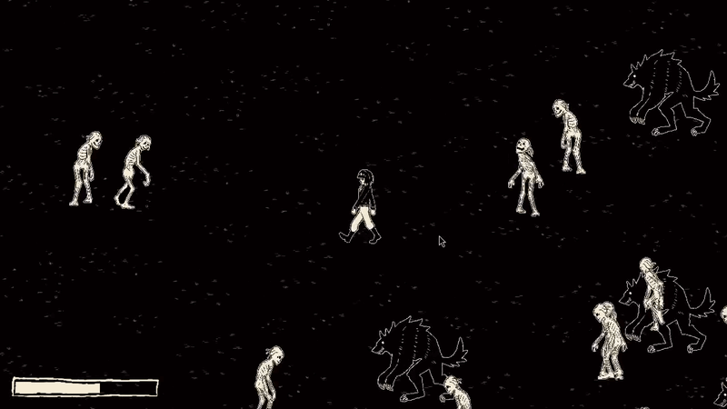
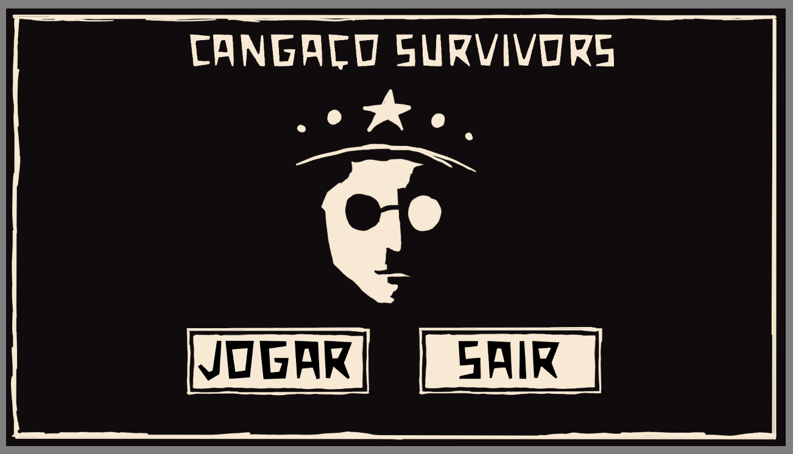
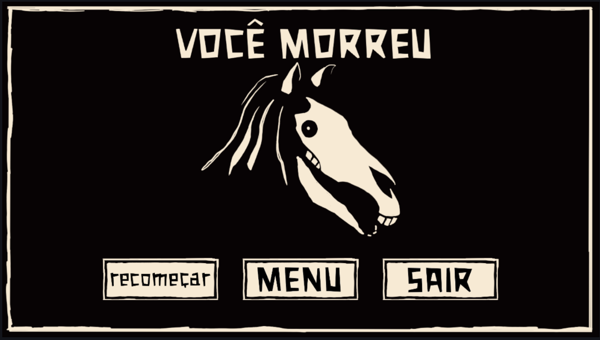
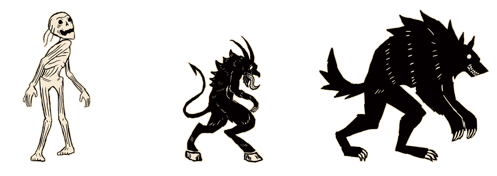
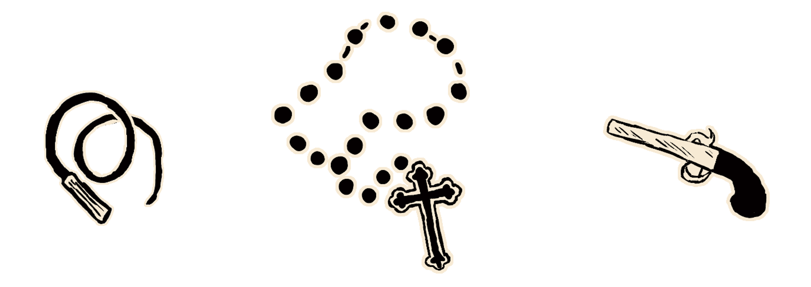

# Cangaço Survivors



A small survivors-like set in the Brazilian Northeast, written in Java with [libGDX](https://libgdx.com/), no engine involved.

Me and a few friends have a hobby of doing game jams together, so when we had to deliver a final project for the object-oriented programming course at college, making a game was the obvious choice. The project looked simple on paper: it had to be in Java and we couldn't use a game engine. It turned out to be way more troublesome than we expected, but we managed to finish a solid core, and I think it came out pretty cool.

This repository is my fork of that project, where I did some clean up (more on that [below](#additions-from-the-fork)).

## Art and theme

I picked the theme because I really love the mystic, supernatural vibe of the old stories from the place I'm from, sometimes called *Nordeste gótico* (Gothic Northeast): cursed people, restless dead, the devil showing up at the crossroads.

All the art was made by me. Since we had very little time, I took heavy references from works I found on Pinterest, and I can't link each one of them here. If you recognize something and want it credited, please contact me.

## Screenshots

| Menu | Game over |
|:---:|:---:|
|  |  |

## The game

You are a lone survivor in the dark, and the night keeps sending things after you. Move around, let your weapons do the work, and last as long as you can while the hordes get bigger. Grab weapon drops along the way, and chickens, which heal you.

### Controls

| Key | Action |
|---|---|
| `W` `A` `S` `D` | Move |
| `ESC` | Pause |

## Features

### Monsters



- **Corpo Seco** is based on the legend of the same name: people who committed sins so horrible that the earth refused their rotten flesh, so they wander around unable to die. In the game they are the base enemy: not so fast, not so slow, not so tanky, not so fragile.
- **Lobisomem** is the classic werewolf. In the stories he is often the seventh son, or cursed for some other reason, who turns into a wolf monster under the full moon and walks around in rage being the only way to break the curse is visiting a bunch of graveyards. In the game he is a tank with a bunch of life, but very slow.
- **Diabo** is the devil of the folk tales, the one you meet where you shouldn't. In the game he is super fast and hard to avoid, but he is a glass cannon and dies easily.

### Weapons



- **Whip**: the starting weapon. It hits horizontally around you from time to time. Simple and efficient.
- **Revolver**: shoots a bullet in a straight line at the closest enemy. High damage, and it pierces enemies to hit a bunch of them, but it has a big cooldown that can leave you hanging against big crowds.
- **Cross**: a holy protection that fits the theme. From time to time it spins around you like a force field, damaging everything close.

## Additions from the fork

- Start menu and game over menu
- ESC now actually pauses the game
- Clean up and bug fixes: dead code removed, enemies spawn outside the screen and are removed when they die, player speed no longer depends on FPS, bullets correctly count how many enemies they pierce
- Fixed the Cross so it behaves the way we originally designed it

## How to run

You need a JDK 11 or newer.

```bash
git clone https://github.com/goyannabernardo/cangaco-survivors-game.git
cd cangaco-survivors-game

# Linux / macOS
./gradlew lwjgl3:run

# Windows
gradlew.bat lwjgl3:run
```

The first run downloads Gradle and the dependencies, so it may take a minute.

To build a runnable jar instead, use `./gradlew lwjgl3:jar`. It ends up in `lwjgl3/build/libs`.

## Credits

Made by me and 3 friends for our object-oriented programming course.